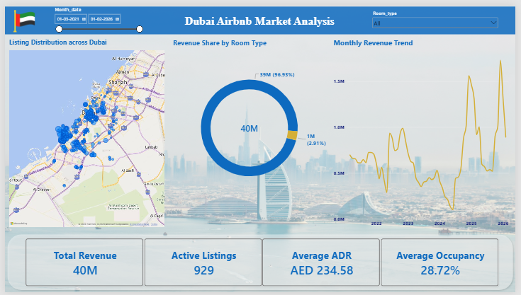
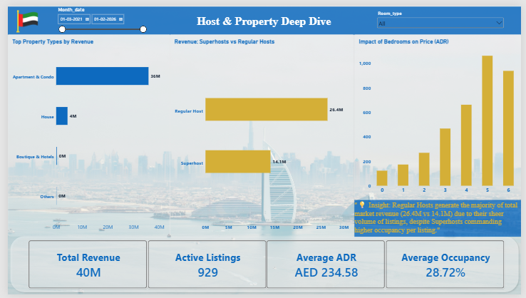

# Dubai Airbnb Market Analytics

An AI-assisted end-to-end data analytics project exploring Dubai's short-term rental market using Python, MySQL and Power BI.

The project analyses listing performance, pricing, occupancy, host categories, property types and bedroom configurations to identify useful business insights.

## Dashboard

### Executive Overview

### Host and Property Analysis

**Power BI Dashboard:** [View PBIX file](powerbi_dashboard.pbix)

## Business Problem

Property investors and short-term rental managers need to understand:

- Which property types generate the highest revenue?
- How do Superhost and regular-host listings compare?
- How does bedroom count affect average daily rates?
- Which neighborhoods have stronger occupancy and revenue?
- Which listings have high prices but low occupancy?
- How does revenue change over time?

## Project Workflow

This project follows an **AI-assisted analytics workflow**. Generative AI tools, including ChatGPT, were used to support coding, debugging, SQL development and documentation.

### 1. Python – Data Preparation
- Used Pandas for data inspection and cleaning.
- Handled missing values.
- Converted date columns into appropriate formats.
- Prepared the monthly listing dataset for analysis.

### 2. MySQL – Business Analysis
Developed 15 SQL business-analysis queries covering:

- Data validation and duplicate checks
- Monthly revenue and occupancy trends
- Superhost versus regular-host performance
- Property type and bedroom analysis
- Revenue growth using `LAG()`
- Neighborhood and host rankings
- Room-type revenue contribution
- Listing performance classification

### 3. Power BI – Dashboard Development
Created a two-page interactive dashboard:

- Executive Overview
- Host and Property Deep Dive

### 4. AI-Assisted Development
AI was used as a coding and problem-solving assistant. Generated suggestions were reviewed and refined to improve query logic, metric definitions and analytical interpretation.

## Key Analytical Areas

- Revenue contribution by property type
- Superhost versus regular-host performance
- Average daily rate (ADR) by bedroom count
- Neighborhood-level performance
- Listing occupancy classification
- Monthly revenue trends

**Note:** Refresh exact business findings and numerical claims after executing the revised SQL queries and reconciling them with the Power BI dashboard.

## Important Metric Definitions and Limitations

- The analysis uses one row per listing per month. A duplicate listing-month validation query is included.
- Listing-level comparisons aggregate monthly observations first, so listings with more observed months do not automatically receive greater weight in average listing performance.
- Total revenue is calculated by summing the existing `revenue` column. Its underlying calculation depends on the source data preparation.
- Occupancy is assumed to be stored as a fraction between 0 and 1.
- Superhost comparisons are descriptive and do not establish causation.
- Neighborhood rankings exclude missing or blank neighborhood names. Missing neighborhood coverage limits geographic analysis.
- Revenue growth comparisons should be interpreted carefully if reporting months are missing.
- Occupancy performance categories use analytical thresholds selected for this project, not universal industry standards.

## Tools and Technologies

| Tool | Purpose |
|---|---|
| Python | Data cleaning and preparation |
| Pandas | Data manipulation |
| MySQL | SQL analysis and business queries |
| Power BI | Dashboard development |
| Generative AI | Coding assistance and debugging |

## Repository Files

- `Airbnb.ipynb` – Python analysis and data preparation
- `Sql_analysis.sql` – SQL business analysis
- `listings_clean.csv` – Cleaned dataset
- `powerbi_dashboard.pbix` – Power BI dashboard
- `page1_executive.png` – Executive dashboard screenshot
- `page2_host_property.png` – Host and property dashboard screenshot

## Author

**Yusuf Baig**  
Aspiring Data Analyst | Python | SQL | Excel | Power BI

- LinkedIn: [Yusuf Baig](https://www.linkedin.com/in/yusuf-baig-783906210/)
- GitHub: [@Yusufbaig2001](https://github.com/Yusufbaig2001)
